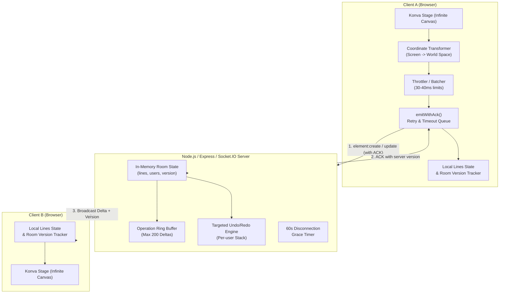
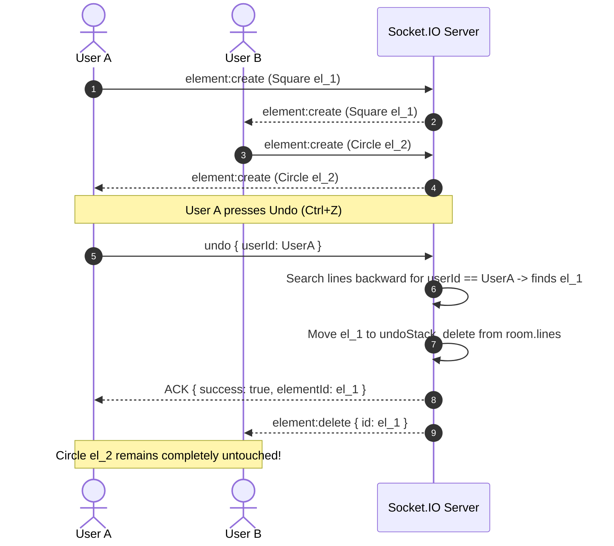

# Real-Time Collaborative Whiteboard — Architecture & Interview Guide

This guide is designed to help you confidently explain this project in technical interviews, system design rounds, and code walkthroughs. It breaks down what makes this project unique, the architectural engineering decisions made, the exact mathematical and networking principles applied, and answers to the toughest interview questions.

---

## 1. Executive Summary & 30-Second Elevator Pitch

> *"I engineered a high-performance, real-time collaborative whiteboard built on Next.js, React-Konva (HTML5 Canvas), and Socket.IO. Unlike naive whiteboard tutorials that continuously broadcast the entire drawing array—causing race conditions, state clobbering, and network flooding—this system employs an **event-driven delta synchronization architecture**, **monotonic sequence versioning with gap recovery**, an **operation-targeted non-destructive undo/redo engine**, **socket ACK retries with exponential backoff**, and an **infinite vector-grade canvas** with pointer-centered zoom ranging from 2% to 5000%. Every object—including uploaded images, rich text, and freehand vectors—is uniquely identified, selectable, draggable, and resizable with normalized coordinate transformations."*

---

## 2. What Makes This Project Unique (Why It Stands Out)

Most portfolio canvas projects implement basic canvas drawing: a single `<canvas>` with `socket.emit("draw", fullState)`. That approach collapses the moment two users draw simultaneously, disconnect briefly, or try to press "Undo".

Here is how this project differs:

| Feature | Naive / Tutorial Implementation | Our Implementation |
| :--- | :--- | :--- |
| **State Synchronization** | Emits entire canvas array (`lines[]`) on every stroke or drag | **Delta / Event-driven**: Emits only `element:create`, `element:update`, `element:delete`, `element:reorder` with specific patches. |
| **Undo / Redo** | `lines.pop()` and broadcasts new array. Deletes other users' work if they drew in between. | **Operation-targeted Undo**: Elements have an immutable `userId` and `id`. Undoing removes the requesting user's latest element without touching peers' work. |
| **Canvas Dimensions** | Fixed canvas size (e.g. 800x600 or window size). Content cuts off on resize. | **Infinite Canvas (Vector-grade)**: Zoom from **2% (0.02x) to 5000% (50x)** centered around the cursor, with infinite multi-modal panning (Hand tool, Spacebar drag, Middle-click). |
| **Coordinate Space** | Screen-space coordinates `(e.clientX, e.clientY)`. Broken when zoomed or panned. | **Dual-Space Matrix Transformation**: Viewport coordinates are transformed into Canvas World coordinates via `(pointer - stagePos) / stageScale`. |
| **Network Reliability** | Fire-and-forget socket emits. Packet drops cause silent, permanent desync. | **Socket ACK with Exponential Backoff Retry**: Automatic retry (up to 3 times) with timeouts to guarantee delivery. |
| **Reconnection & Catch-Up** | Reconnecting client either wipes canvas or reloads the entire page. | **Monotonic Versioning & Ring Buffer Catch-Up**: Server maintains room sequence number and a 200-item operation log. Reconnecting clients fetch only missed deltas. |
| **Network Traffic** | Emits mouse move / drag events on every pixel change (thousands of msgs/sec). | **Timestamp & Frame Throttling**: `mouseMove` (40ms), `drawProgress` (30ms), and `shapeMove` (35ms) limit socket traffic by >85%. |
| **Objects & Images** | Images are static background fills; text is static or non-transformable. | **First-Class Interactive Objects**: Images and text are selectable, draggable, and resizable with Konva `Transformer`, double-click inline editing, and z-ordering. |

---

## 3. System Architecture & Data Flow



---

## 4. Deep-Dive into the Core Technical Pillars

### Pillar 1: Unique Element IDs & Granular Delta Updates
- **Problem**: In a standard whiteboard, `socket.emit("updateElements", lines)` overwrites the array. If User A draws a circle while User B moves a rectangle, whichever payload arrives last permanently overwrites the other user's change.
- **Solution**: Every element (stroke, rectangle, circle, line, text, image) receives a globally unique, collision-resistant ID upon creation:
  ```ts
  export function generateId(prefix = "el"): string {
    return `${prefix}_${Date.now().toString(36)}_${Math.random().toString(36).substring(2, 9)}`;
  }
  ```
- **Socket Events**:
  - `element:create`: Dispatches newly created element `{ element: LineData }`.
  - `element:update`: Dispatches mutation patches `{ id: string, patch: Partial<LineData> }` (e.g. position `x, y`, dimension `width, height`, or content).
  - `element:delete`: Dispatches `{ id: string }`.
  - `element:reorder`: Dispatches `{ id: string, to: "front" | "back" }`.

### Pillar 2: Targeted, Non-Destructive Undo/Redo
- **Problem**: In multi-user environments, global undo (`lines.pop()`) is fatal. If User A draws, User B draws, and User A clicks "Undo", User A accidentally erases User B's drawing!
- **Solution**: Undo is modeled as an **operation**, not an array pop.
  - When User A requests `undo`, the client sends `{ roomId, userId: socket.id }`.
  - The server inspects `room.lines` in reverse order specifically for elements where `element.userId === socket.id`.
  - The server extracts that specific element, stores it in `room.undoStack` with the user ID, and broadcasts `element:delete` to all clients.
  - When User A requests `redo`, the server finds the latest item in `undoStack` belonging to that user, re-appends it to `room.lines`, and broadcasts `element:create`.
  - **Result**: User A can undo and redo their own contributions without affecting peers.



### Pillar 3: Throttling & Batching High-Frequency Events
- **Problem**: Pointer movements (`pointermove`) and shape drags fire up to 120-240 times per second per user. For 10 users, this yields thousands of WebSocket frames per second, saturating the client event loop and exhausting server bandwidth.
- **Solution**: Targeted throttling using timestamp deltas:
  - **Cursor Tracking (`mouseMove`)**: Throttled to **40ms** (25 updates/sec).
  - **Freehand Stroke In-Flight Updates (`drawProgress`)**: Throttled to **30ms** (~33 fps) while drawing; the final stroke with all vertices is committed once on `pointerup`.
  - **Live Shape Dragging (`shapeMove`)**: Throttled to **35ms** (~28 fps) for smooth peer preview, followed by a final delta update on drag end.

### Pillar 4: Socket ACK + Exponential Backoff Retry
- **Problem**: WebSocket transport is reliable (TCP), but application-level message delivery can fail due to socket reconnects, brief Wi-Fi drops, or server-side packet processing drops.
- **Solution**: Implemented `emitWithAck<T>` ([utils/socketUtils.ts](file:///e:/Downloads/collaborative-whiteboard-main/collaborative-whiteboard-main/utils/socketUtils.ts)):
  ```ts
  export async function emitWithAck<T>(
    socket: Socket,
    event: string,
    data: any,
    options: { timeoutMs?: number; retries?: number; backoffFactor?: number } = {}
  ): Promise<T>
  ```
  - Emits the event and sets a timeout (default 3000ms).
  - If the server does not execute the callback before the timeout, it initiates retry with exponential backoff: `delay = 300ms * (1.5 ^ attempt)`.
  - Re-attempts up to 3 times before rejecting, ensuring zero silent element drops.

### Pillar 5: Monotonic Sequence Versioning & Gap Recovery
- **Problem**: If a user experiences a 2-second network stall or mobile screen lock, they miss broadcasts. When they reconnect, their canvas state is out of sync.
- **Solution**:
  - The server maintains a monotonic integer `room.version` (incremented on every operation) and a bounded ring buffer of the last 200 operations:
    ```ts
    interface OperationRecord {
      version: number;
      type: string;
      payload: any;
      timestamp: number;
    }
    ```
  - Every server broadcast and ACK carries the latest `version`.
  - **Gap Detection**: If a client receives an event with `version > clientVersion + 1`, it detects missed operations and requests `syncRoom({ fromVersion })`.
  - **Catch-up on Reconnect**: On socket `reconnect`, `joinRoom` sends `lastVersion: lastVersionRef.current`. If within the 200-op window, the server returns only the missing operations (`catchUp` event), avoiding a heavy full-canvas reload.

---

## 6. Infinite Vector Canvas: Mathematical Foundations

### 1. Dual Coordinate Spaces
The whiteboard separates the screen into two coordinate spaces:
1. **Screen / Viewport Space**: The raw pixel position of the browser window (`e.clientX`, `e.clientY`).
2. **Canvas World Space**: The virtual, infinite Euclidean plane where drawings, shapes, and images live `(x, y)`.

```
                    ┌───────────────────────────────────────────────┐
                    │               Infinite Canvas                 │
                    │                  (World Space)                │
                    │                                               │
                    │         ┌───────────────────────┐             │
                    │         │    Viewport Window    │             │
                    │         │    (Screen Space)     │             │
                    │         │                       │             │
                    │         │   (pointer.x, .y)     │             │
                    │         │          x            │             │
                    │         │                       │             │
                    │         └───────────────────────┘             │
                    │                                               │
                    └───────────────────────────────────────────────┘
```

The transformation equation implemented in `getWorldPointer()`:
$$worldX = \frac{pointer.x - stagePos.x}{stageScale}$$
$$worldY = \frac{pointer.y - stagePos.y}{stageScale}$$

### 2. Pointer-Centered Zoom Math
When zooming with the mouse wheel, the point directly beneath the user's cursor must remain stationary on screen, exactly like Google Maps, Figma, or Miro.

Given:
- Old scale: $S_{old}$
- New scale: $S_{new}$
- Stage offset: $(X_{old}, Y_{old})$
- Mouse position in viewport: $(P_x, P_y)$

The mouse position in world space before zoom:
$$W_x = \frac{P_x - X_{old}}{S_{old}}, \quad W_y = \frac{P_y - Y_{old}}{S_{old}}$$

To keep $W$ invariant under $S_{new}$:
$$X_{new} = P_x - W_x \cdot S_{new}$$
$$Y_{new} = P_y - W_y \cdot S_{new}$$

This enables seamless zoom from **2% (0.02x)** all the way to **5000% (50x)** without jitter.

---

## 7. Interactive Objects & The Konva Transformer

### Images as Interactive Elements
- In traditional canvases, images are loaded as background tiles that cannot be moved.
- In this project, uploading an image creates a `type: "image"` `LineData` element placed at the exact center of the current infinite viewport:
  ```ts
  const posX = Math.round((-stage.x() + stage.width() / 2) / scale - w / 2);
  const posY = Math.round((-stage.y() + stage.height() / 2) / scale - h / 2);
  ```
- Rendered via a dedicated `CanvasImageItem` subcomponent using `use-image` hook, allowing caching, drag, select, and scale.

### Normalizing Transformer Scales
When using `Konva.Transformer` to resize rectangles, images, or text, Konva applies `scaleX` and `scaleY` to the node matrix instead of changing width and height. If not handled, this causes distorted stroke borders and broken bounding boxes.

**The Fix** (`handleTransformEnd`):
```ts
const node = selectedNodeRef.current;
const scaleX = node.scaleX();
const scaleY = node.scaleY();

// Reset node scale back to 1
node.scaleX(1);
node.scaleY(1);

// Persist real dimensions
const patch: Partial<LineData> = {
  x: Math.round(node.x()),
  y: Math.round(node.y()),
  width: Math.max(10, Math.round(node.width() * scaleX)),
  height: Math.max(10, Math.round(node.height() * scaleY)),
};
```

### Editable Text System
- Text elements can be dragged and resized (which dynamically scales `fontSize`).
- **Double-Click Inline Editing**: Double-clicking a text node calculates its exact screen-space matrix position and mounts an absolute HTML `<textarea>` over the canvas with matching font size, color, and line height. When blurred or when Enter is pressed, it commits a delta update.

---

## 8. Key Files & Codebase Tour

- [types/types.ts](file:///e:/Downloads/collaborative-whiteboard-main/collaborative-whiteboard-main/types/types.ts): Data contracts for `ElementData`, `RoomOperation`, `AckResponse`, and ID generator.
- [utils/socketUtils.ts](file:///e:/Downloads/collaborative-whiteboard-main/collaborative-whiteboard-main/utils/socketUtils.ts): `emitWithAck` utility with timeout, retries, and exponential backoff.
- [server/server.ts](file:///e:/Downloads/collaborative-whiteboard-main/collaborative-whiteboard-main/server/server.ts) & [server/server.js](file:///e:/Downloads/collaborative-whiteboard-main/collaborative-whiteboard-main/server/server.js): Express + Socket.IO server handling room memory, operation ring buffer, versioning, targeted undo/redo, and 60-second room cleanup grace timer.
- [components/Whiteboard.tsx](file:///e:/Downloads/collaborative-whiteboard-main/collaborative-whiteboard-main/components/Whiteboard.tsx): The core React-Konva infinite canvas with wheel zoom math, world pointer mapping, Konva Transformer, throttling, and tool handling.
- [components/Main.tsx](file:///e:/Downloads/collaborative-whiteboard-main/collaborative-whiteboard-main/components/Main.tsx): State orchestration, socket delta listeners, gap detection (`syncRoom`), image uploads, and hotkeys (Ctrl+Z, H for Hand tool, Delete).
- [components/Toolbar.tsx](file:///e:/Downloads/collaborative-whiteboard-main/collaborative-whiteboard-main/components/Toolbar.tsx): Tool selector with Brush, Eraser, Shapes (Rect, Circle, Line), Text, Select tool, and Hand/Pan tool.
- [pages/[roomId].tsx](file:///e:/Downloads/collaborative-whiteboard-main/collaborative-whiteboard-main/pages/[roomId].tsx): Dynamic room routing, reconnect listener, and user list.

---

## 9. Top 10 Interview Questions & Model Answers

### Q1: "Why did you use Delta updates instead of broadcasting the full canvas state?"
> **Answer**: *"Broadcasting the full array is $O(N)$ in payload size and has a catastrophic race condition: if two users make edits simultaneously, the second incoming array clobbers the first, losing data. Delta updates (`element:create`, `element:update`, `element:delete`) are $O(1)$ in payload size, bandwidth-efficient, and allow concurrent operations on different elements without conflicts."*

### Q2: "How does your Undo/Redo mechanism work in a multi-user environment?"
> **Answer**: *"Standard undo pops the last element of the global array. In a collaborative session, if User B draws after User A, User A's undo would delete User B's drawing. To solve this, every element records its author's `userId`. When a user requests Undo, the server traverses the room's elements backwards to find the latest element authored by that specific user, moves it to a per-room undo stack, and broadcasts an `element:delete` event. Redo reverses this by restoring that user's element with `element:create`."*

### Q3: "How does the infinite zoom and panning math work?"
> **Answer**: *"The HTML5 canvas uses a dual coordinate system: Viewport space (pixels on screen) and World space (coordinates on the infinite canvas). During zoom, we calculate the mouse cursor's position in World space before the scale change: `worldX = (mouseX - stageX) / oldScale`. Then, we compute the new stage offsets so that the same world coordinate remains directly under the mouse cursor after applying `newScale`: `newStageX = mouseX - worldX * newScale`. This guarantees smooth, anchor-centered zooming up to 5000%."*

### Q4: "How do you handle dropped packets or spotty mobile connections?"
> **Answer**: *"First, all client mutations use a custom `emitWithAck` wrapper with a 3000ms timeout and exponential backoff retry. Second, the server assigns a monotonic version sequence to every operation and keeps the last 200 operations in a memory ring buffer. If a client receives version $N+2$ while on version $N$, it detects a sequence gap and requests missing operations via `syncRoom`. On complete socket reconnection, the client sends its `lastVersion`, allowing the server to replay only missed deltas rather than resending the entire canvas."*

### Q5: "Why not use a full CRDT library like Yjs or Automerge?"
> **Answer**: *"For a whiteboard where objects (strokes, shapes, text, images) are discrete entities, a lightweight Operation-based Delta Sync with monotonic sequence numbers delivers 95% of the benefits of a CRDT with significantly less computational and memory overhead. CRDTs excel at character-by-character string concurrency, but for discrete graphics, deterministic delta events with element-level locking or Last-Write-Wins timestamps provide superior rendering performance at 60fps."*

### Q6: "How do you prevent WebSocket flooding during rapid mouse movements or dragging?"
> **Answer**: *"High-frequency events are throttled at the client level. Cursor broadcasts are throttled to 40ms (~25Hz), live shape dragging to 35ms (~28Hz), and freehand drawing progress to 30ms (~33Hz). When the user releases the mouse (`pointerup`), the throttler immediately flushes the final definitive state with the complete vertex array."*

### Q7: "What happens when a user resizes an element with Konva's Transformer?"
> **Answer**: *"Konva's Transformer modifies the node's `scaleX` and `scaleY` properties rather than its width and height. If left as-is, this causes skewed stroke borders and broken bounding boxes. In `handleTransformEnd`, we read the transformed dimensions, multiply `width * scaleX` and `height * scaleY`, reset the node's internal scale factors back to 1.0, and commit the normalized dimensions to state."*

### Q8: "How is room lifecycle and memory cleanup managed on the server?"
> **Answer**: *"Rooms are stored in an in-memory dictionary. When the last user disconnects, the server does not immediately delete the room because momentary network drops or page reloads would cause catastrophic data loss. Instead, it arms a 60-second grace timer. If any user rejoins within 60 seconds, the timer is cleared; if the room remains empty after 60 seconds, it is safely garbage collected."*

### Q9: "How did you ensure image elements are first-class canvas citizens?"
> **Answer**: *"Instead of drawing images into a static background layer, images are modeled as `LineData` elements with `type: "image"` and a base64 or URL `src`. They are instantiated at the center of the current viewport, rendered using a React-Konva `<Image>` subcomponent with an asynchronous image loader (`use-image`), and hooked up to the same selection, dragging, z-ordering, and Transformer resizing pipeline as geometric shapes."*

### Q10: "If this application had to scale to 100,000 active rooms, what would you change?"
> **Answer**:
> 1. *"**Horizontal Scaling**: Replace single-node in-memory state with a Redis Pub/Sub adapter (`@socket.io/redis-adapter`) to distribute rooms across multiple Node.js instances."*
> 2. *"**State Persistence**: Store room snapshots in PostgreSQL or MongoDB, and store operation logs in Redis Streams."*
> 3. *"**Asset Storage**: Store uploaded images in an S3-compatible object store (AWS S3 / Cloudflare R2) with CDN URLs rather than passing base64 strings through WebSockets."*
> 4. *"**Binary Protocol**: Migrate high-frequency cursor and stroke points from JSON to Protocol Buffers or MessagePack to reduce bandwidth by up to 70%."*

---

## 10. Quick Start & Testing Instructions

### Prerequisites
- Node.js 18+ installed

### Running Locally
```bash
# Terminal 1: Start Backend Server (Port 3001)
npm run server

# Terminal 2: Start Next.js Frontend (Port 3000)
npm run dev:client
```
Visit `http://localhost:3000` to enter or create a room.

### Testing Collaboration Locally
1. Open `http://localhost:3000` in two separate browser windows (or an Incognito window).
2. Enter the same room name (e.g. `room123`).
3. Verify:
   - Live multi-user cursors with user names and colors.
   - Drawing on Window 1 appears instantly on Window 2.
   - Uploading an image allows dragging and resizing on both screens.
   - Zoom in/out with the mouse wheel or Zoom HUD (+ / - / Reset).
   - Pressing Ctrl+Z on Window 1 only undoes Window 1's elements.

